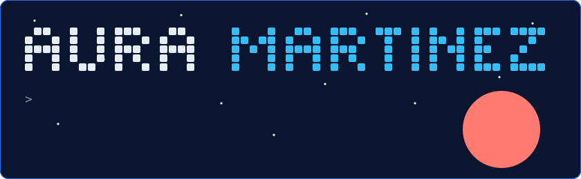
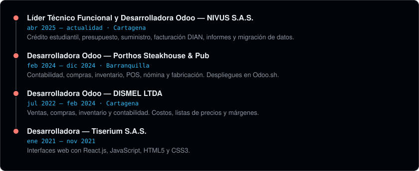

  

  
  
  
  

### `$ whoami`

  

Soy líder técnico funcional y desarrolladora Odoo, con más de 4 años construyendo soluciones empresariales. Mi especialidad es el área financiera: me siento con los equipos de contabilidad, presupuesto y cartera, entiendo cómo trabajan y convierto esa necesidad en software que funciona.

### `$ ls especialidad/`

  

### `$ cat tech-stack.yaml`

  
  

  

### `$ ls proyectos/`

| Proyecto | Tecnologías | Estado |
| --- | --- | --- |
| **Control de presupuesto** — ingresos, gastos y tablero con login | MongoDB · Express · React · Node.js | En construcción |
| [**Simulador de crédito**](https://github.com/AURACHICO/simulador-credito-js) — cuotas y tabla de amortización | JavaScript | Publicado |
| **Cartera en PostgreSQL** — modelo de datos y edades de cartera | SQL · vistas · funciones | En construcción |
| **Landing personal** — página responsive | HTML5 · CSS3 · Sass | En construcción |

### `$ git log --experiencia`

  

### `$ git contribuciones`

  

<i>"Convierto procesos financieros en software que funciona."</i>

